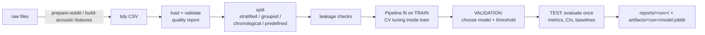

# MindText - mental-health-related text & acoustic-feature classification

> **Research / educational project - not a diagnostic tool.** Models trained on Reddit posts or a few hundred interview recordings cannot assess any individual. Outputs are experimental class predictions, not diagnoses, risk assessments, or advice. See [docs/limitations.md](docs/limitations.md).

## 1. Overview
This repository turns ten exploratory Kaggle notebooks into a reproducible package with a CLI, configs, tests and documentation. The notebooks cover **two separate problems that use different datasets and are never mixed**:

| track | data | task | historical notebooks |
|---|---|---|---|
| `text` | Reddit mental-health posts (≈1.0 M after the original filtering) | 5-class: anxiety / depression / lonely / mentalhealth / suicidewatch (label = source community, *inferred* from file names) | `preprocessing-reddit-data`, `reddit-dataset-model` |
| `tabular` | E-DAIC interviews, 275 participants, openSMILE audio statistics | binary `PHQ_Binary`, official train/dev/test split | `EDAIC_EDA`, `edaic-data-preparation-*`, `edaic-audio-modeling`, `svm-lr`, `random-forest` (= XGBoost), `feature-audit`, `bilstm` |

Full inventory: [docs/original_inventory.md](docs/original_inventory.md).

## 2. What is new vs. what you already did
* **From your notebooks (re-implemented, retrained under a stricter protocol):** TF-IDF + {Naive Bayes, Logistic Regression, LinearSVC, Random Forest, LightGBM}; acoustic aggregation (23 LLD × 7 statistics, or 69+117 mean/std/median) + {Logistic Regression, SVM-RBF, Random Forest, XGBoost}; dev-set thresholding; ANOVA feature selection inside CV. Config entries carry `provenance: original`.
* **New:** validated ingestion + quality report; configurable text cleaning (negations/punctuation kept by default); duplicate/placeholder policies; stratified/grouped/chronological/predefined splits with leakage checks; majority/all-positive baselines; bootstrap CIs; error analysis with redacted excerpts; checksum-verified model files; CLI; tests; CI. One new model variant (`logreg_balanced`).
* **Not ported:** the BiLSTM (needs PyTorch; kept in `notebooks/original/bilstm__2_.ipynb`; its historical test F1 was 0.316) and the PCA variant of logistic regression.

## 3. Your historical results are context, not results of this code
All numbers from your notebooks are in [docs/original_results.md](docs/original_results.md) with caveats. Highlights an interviewer will ask about:
* Reddit, 20 % random hold-out: accuracy 0.64-0.69 and macro-F1 0.32-0.51 across five models; recall for `suicidewatch` (0.01-0.15) and `mentalhealth` (0.03-0.20) was very low. Not shown to be leakage-free (no duplicate/author handling).
* **The Reddit label mapping discarded 772,084 of 1,797,016 posts (43 %) because of file-name prefixes** - the class balance is partly an artefact. Fixed in `mindtext.ingest`.
* E-DAIC test (56 people, 17 positive): best reported F1 0.588 (XGBoost, ROC-AUC 0.747), **but the all-positive rule scores F1 0.466** and three reported runs are (near) all-positive. Bootstrap 95 % intervals overlap (e.g. 0.36-0.76 for XGBoost).

**No new real-data results are reported here.** The datasets were not available when this repository was built; every run executed during assembly used synthetic data. Run the pipeline on your data and add *your* numbers to this section.

## 4. Pipeline

Details: [docs/methodology.md](docs/methodology.md). Data provenance and open questions: [docs/data_card.md](docs/data_card.md).

## 5. Install
```bash
unzip MindText.zip && cd MindText
python -m venv .venv && source .venv/bin/activate
pip install -e ".[dev]"            # core + pytest + ruff
pip install -e ".[boosting]"       # optional: xgboost, lightgbm
pip install -e ".[nlp]"            # optional: nltk (lemmatisation / legacy cleaning)
pip install -e ".[app]"            # optional: streamlit demo
```
Developed and tested locally with Python 3.12.3, numpy 2.4.4, pandas 3.0.2, scikit-learn 1.8.0. GitHub Actions installs the newest scikit-learn (1.9 at the time of writing), which exposed a Random Forest `class_weight` failure that is now worked around (see `BalancedSampleWeightClassifier`); other 1.9 differences may remain; lower bounds in `pyproject.toml` are declared, not verified.

## 6. Quick start (synthetic data, works immediately)
```bash
python -m mindtext data-check --data data/sample.csv --config configs/default.yaml
python -m mindtext train --config configs/default.yaml           # text track
python -m mindtext train --config configs/acoustic.yaml          # tabular track (overwrites artifacts/model.joblib)
python -m mindtext report --latest
python -m mindtext predict --model artifacts/model.joblib --input data/sample_acoustic.csv
```
Scores on the synthetic samples are meaningless by construction.

## 7. CLI
| command | purpose |
|---|---|
| `data-check --data F [--config C] [--out J]` | schema, missing/malformed rows, label validity, duplicates, class balance; exit 1 on errors |
| `train --config C [--data F]` | run the full protocol, write `reports/<run>/` and `artifacts/<run>/model.joblib` |
| `evaluate --model M --data F` | score a saved model on a labelled file (do not use training data) |
| `predict --model M (--text T … \| --input F)` | illustrative predictions + disclaimer |
| `report (--latest \| --run-id ID \| --path P)` | summary of a run (`--json` for raw) |
| `prepare-reddit`, `build-acoustic-features` | raw files → tidy CSV (see [data/README.md](data/README.md)) |
| `make-sample` | write a synthetic demo CSV |

## 8. Reproducing your experiments on real data
1. Obtain the datasets ([data/README.md](data/README.md)) - they are not bundled.
2. Text: `prepare-reddit` → `data-check` → `train --config configs/default.yaml --data data/reddit_mental_health.csv` (add `rf`/`lightgbm` entries as in the config comments). `configs/reddit_replication.yaml` approximates the original preprocessing (needs nltk data) but still uses a validation split, so it will not equal the old numbers exactly.
3. Acoustic: `build-acoustic-features` → `train --config configs/acoustic.yaml --data data/edaic_features.csv`. The default masks the `-201` sentinel, so results will differ from the 161-feature notebooks (which kept it) - see original_results C-7.
4. Compare with the all-positive baseline and the bootstrap CI printed in the report before drawing conclusions.

## 9. Outputs of a run (`reports/<run_id>/`)
`report.json` (config, data hash, split sizes, leakage checks, per-model val/test metrics, CIs, thresholds, warnings, environment) · `summary.md` · `figures/*.png` (class distribution, model comparison, confusion matrix, per-class metrics, PR curve) drawn from the computed results · `predictions/*.csv` · `error_analysis.json` (false positives/negatives or top confusions with record ids, scores, redacted excerpts; top model terms with caveat) · `data_quality.json` · `split_assignments.csv.gz`.

## 10. Tests
```bash
pytest
```
Synthetic fixtures only; no downloads. In the build environment `pytest` could not be installed (offline), so the 103 test functions (125 cases after parametrisation) were run with a small stand-in runner: **123 passed, 2 skipped** (xgboost/lightgbm not installed). Real `pytest` and `ruff`, and the GitHub Actions workflow (`.github/workflows/ci.yml`), have **not** been run - run them once and fix anything they flag.

## 11. Optional demo app
`streamlit run app/streamlit_app.py` shows the latest report and a text demo with prominent disclaimers; it never shows placeholder metrics. It was syntax-checked but **not run** (streamlit unavailable). The CLI and package do not need it.

## 12. Limitations, ethics, known issues
See [docs/limitations.md](docs/limitations.md). In short: labels are not diagnoses; data are non-representative; the acoustic test set is tiny; Reddit author/near-duplicate leakage cannot be excluded; explanations are associations; model files are pickles (load only trusted ones).
Known issues: lint (`ruff`) and CI untested; XGBoost/LightGBM code paths untested here; `pandas<2.1`/older scikit-learn untested; the text TF-IDF tokenizer drops punctuation/emoji unless `tfidf.token_pattern` is changed; the Reddit field names `id/author/created_utc` are assumed, not verified.

## 13. Future work
Ablations on the real Reddit data (stop-words, punctuation tokens, lemmatisation, class weights); author-grouped and time-based splits if metadata exist; repeated/nested CV for the 275-participant set; calibration; the BiLSTM port; transcript (text) features for E-DAIC; fairness analysis.

## 14. Attribution
Datasets: cite the original Reddit dataset and E-DAIC/DAIC-WOZ publications from their official pages (not reproduced here because the supplied materials do not contain them - **confirm and add**). Notebooks in `notebooks/original/` are your original work as supplied (confirm co-author consent before publishing); code in `mindtext/` is MIT-licensed (fill in the copyright holder in `LICENSE`).
